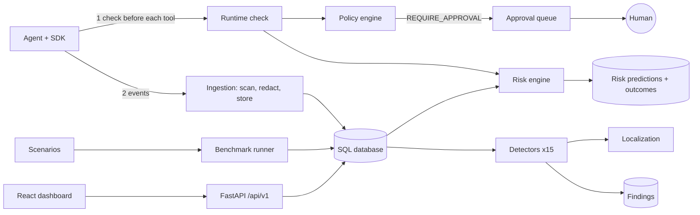

# System architecture

Modular monolith: `app/api` (routes), `app/detectors`, `app/risk`, `app/runtime` (policy engine), `app/recovery` (simulated), `app/evaluation` (benchmark), `app/services`, `app/db`. Everything is scoped by workspace. The runtime check is the only synchronous path an agent waits on; it reads the run's stored events, evaluates policies and risk, records a `policy_check` (and `risk_detected`) event, and returns allow / not allowed with a reason. Detection, risk replay and the cached run summary are recomputed on every ingest.
