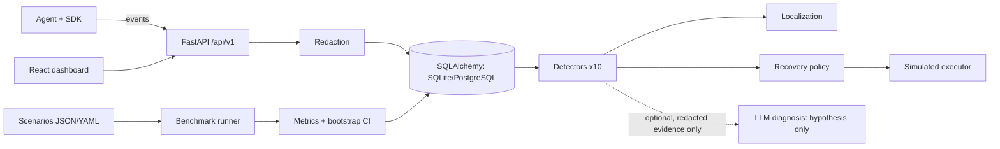

# Architecture

Data flow: events are validated (Pydantic), redacted, stored idempotently by `(trace_id, event_id)`, read back sorted by `step_index`. Detectors are pure functions `events -> findings`. Localization reports origin, first detectable and last observed events and returns *unresolved* when it cannot tell. The recovery policy sees only events and findings; ground truth never reaches it. Executors are simulations; consequential actions always escalate.
